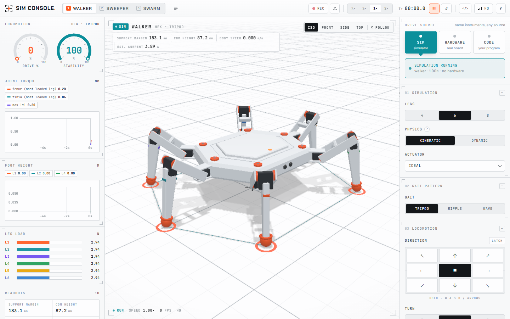
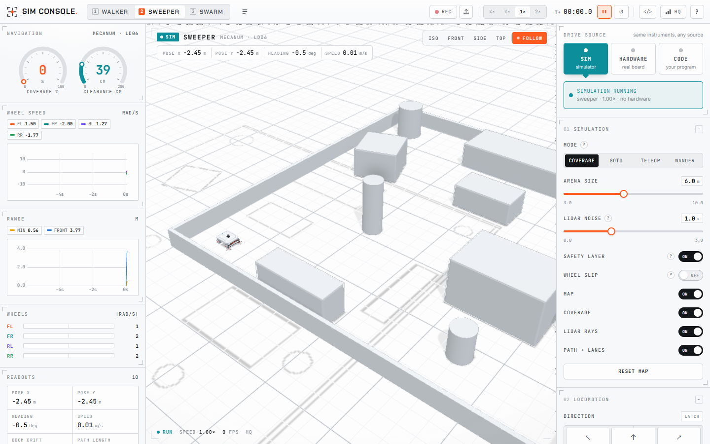
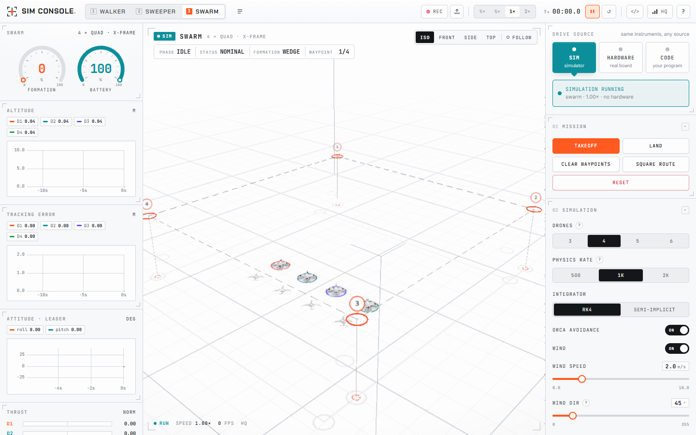
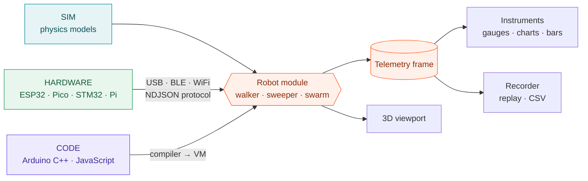

<!-- ════════════════════════════════════════════════════════════════════ -->
<!--                             SIM CONSOLE                               -->
<!-- ════════════════════════════════════════════════════════════════════ -->

<div align="center">

<!-- animated banner — loops live on GitHub (hand-built SVG + SMIL) -->


<br/>

[](LICENSE)
[](https://zero-state-logic.github.io/Sim-Console/)
[](https://github.com/Zero-State-Logic/Sim-Console/releases/latest)
[](#-link-your-real-robot)
[](https://github.com/Zero-State-Logic/Sim-Console/actions)
[](#-contributing)

**A robot simulator, hardware bench and code sandbox in one — for a 4/6/8-leg walker, a mecanum LiDAR sweeper and a quadrotor swarm.**
Simulate it, link your real board, or drive it with your own Arduino code. The instruments can't tell which.

[▶ Open the live app](https://zero-state-logic.github.io/Sim-Console/) · [⬇ Download](#%EF%B8%8F-download--run) · [Features](#-features) · [How it works](#-how-it-works) · [Link a robot](#-link-your-real-robot) · [Physics](#-physics--accuracy-honest) · [FAQ](#-faq)

</div>

> [!TIP]
> **New here?** The app opens with a short guided tour of every panel. Skip it any time, and replay it later from **Help → Take the tour**.

---

## 🛰 What is SIM CONSOLE?

Building a robot usually means three separate tools: a simulator to design it, a serial monitor to talk to the real board, and an IDE to test your code. Each speaks its own language, so nothing you learn in one carries over to the next.

**SIM CONSOLE puts all three on one bench.** Pick a robot, tune it in simulation, then flip one switch and the *same* sliders drive your real ESP32 robot while the *same* gauges read its real joint angles and loads. Flip it again and your own Arduino sketch drives the robot instead. Sim to design it, hardware to prove it, code to test it — and the instruments never change.

It runs entirely in your browser (nothing to install) or as a desktop app for Windows, macOS and Linux.

<div align="center">

<br><sub>The WALKER on a tripod gait — joint torque, foot height and per-leg load come straight from the kinematics and statics, not decoration.</sub>
</div>

---

## ⬇️ Download & run

<table>
<tr>
<td width="50%" valign="top">

### 🌐 In your browser — no install
Open **[zero-state-logic.github.io/Sim-Console](https://zero-state-logic.github.io/Sim-Console/)** in **Chrome or Edge**.
Everything works there, including USB and Bluetooth links to real boards.

</td>
<td width="50%" valign="top">

### 💻 As a desktop app
Grab the installer for your system from the **[latest release](https://github.com/Zero-State-Logic/Sim-Console/releases/latest)**.
The desktop app also links **WiFi boards directly** (no relay needed).

</td>
</tr>
</table>

| System | File | Notes |
| --- | --- | --- |
| 🪟 **Windows 10/11** | `SIM-Console-Setup-x.y.z.exe` | Installer with Start-menu and desktop shortcuts |
| 🪟 Windows (portable) | `SIM-Console-Portable-x.y.z.exe` | No install — run it from anywhere, even a USB stick |
| 🍎 **macOS** (Apple Silicon & Intel) | `.dmg` | Drag SIM CONSOLE into Applications |
| 🐧 **Linux** | `.AppImage` / `.deb` | `chmod +x` the AppImage and run it, or `sudo apt install ./<file>.deb` |

> [!NOTE]
> The builds are free and open source but not code-signed (signing certificates cost money every year). The first time you open it, **Windows** may show *"Windows protected your PC"* → **More info → Run anyway**. On **macOS**, right-click the app → **Open** → **Open** (if it says the app is damaged, run `xattr -cr "/Applications/SIM CONSOLE.app"`). On **Linux**, add yourself to the `dialout` group for USB boards.

---

## ✨ Features

<table>
<tr>
<td width="33%" valign="top">

### 🕷️ Walker
4, 6 or 8 legs, switchable live. Closed-form 3-DOF IK, crawl / trot / pace and tripod / ripple / wave gaits, body pose, real servo models — and a **DYNAMIC** mode on a rigid-body engine where it can slip and tip.

</td>
<td width="33%" valign="top">

### 🧹 Sweeper
A digital twin of a mecanum robot with an **LD06 LiDAR**. Builds its map from the scans, plans with A\*, sweeps with boustrophedon coverage, and dodges the obstacles you drag into its arena.

</td>
<td width="33%" valign="top">

### 🚁 Swarm
3–6 quadrotors with full **12-state rigid-body dynamics**, cascaded PID you can tune, five formations, reciprocal collision avoidance, wind gusts and a battery model. Click to drop waypoints.

</td>
</tr>
<tr>
<td valign="top">

### 🔌 Hardware link
USB (Web Serial), Bluetooth LE or WiFi. Home-first handshake, E-STOP, a live serial monitor, a per-leg telemetry table and a calibration tool. A **Virtual Device** lets you try it all with no board.

</td>
<td valign="top">

### 🧩 Firmware generator
Pick your board and wiring and it writes the code: ESP32, Pico, Pico W, STM32 and a Pi Zero 2 W daemon. Paste one header, add **two lines** to your sketch, flash, connect.

</td>
<td valign="top">

### 💻 Code sandbox
Write **Arduino C++** — run by a built-in compiler and VM with real C integer maths and `delay()` — or JavaScript. `Servo.attach(pin)` maps to the robot's joints, so your real sketch drives the sim.

</td>
</tr>
<tr>
<td valign="top">

### 📈 Instruments
Gauges, live charts, load bars and readouts that read the same telemetry from the sim, a real board or your code. Record two minutes, scrub it back, export CSV.

</td>
<td valign="top">

### 🎯 Smooth & precise
A frame pacer and interpolated fixed-step physics keep motion even at any refresh rate. Tests hold every robot to it — the same pose at 60 Hz and at a ragged frame rate, within 2 mm.

</td>
<td valign="top">

### 🧭 Guided tour
First launch walks you through every panel in ten short steps, with **Skip** on every one. Keyboard shortcuts throughout (`?` for help).

</td>
</tr>
</table>

<div align="center">


<br><sub>The SWEEPER in its arena (left) and the SWARM on its pads with the waypoint route (right).</sub>
</div>

---

## 🛠 How it works

The whole app is built around one idea: **every robot is a module behind one contract**, and the *drive source* is just where that module's commands come from.



**SIM** computes the telemetry. **HARDWARE** reads it off the wire from your board. **CODE** produces it from your controller. No instrument ever branches on the source — that's why the gauges you tuned in simulation read your real robot unchanged.

---

## 🔌 Link your real robot

1. Open **FIRMWARE** and pick your robot, board, link and servo driver (direct GPIO or a PCA9685).
2. Put the generated `kiyobridge.h` next to your sketch and add two lines:

   ```cpp
   #include "kiyobridge.h"   // generated for your board and wiring — paste once

   void setup() { Bridge.begin(); }   // opens the link, homes the servos
   void loop()  { Bridge.update(); }  // routes every command and telemetry frame
   ```

3. Flash it with the Arduino IDE or PlatformIO (the download includes the library list and a wiring table).
4. Switch the console to **HARDWARE**, pick the link and press **CONNECT**. The board announces itself, the console checks it matches, homes it to a safe pose, and goes **LIVE**.

| Board | USB | Bluetooth LE | WiFi | Notes |
| --- | :---: | :---: | :---: | --- |
| **ESP32** | ✅ | ✅ | ✅ | The best target — build it first |
| **Raspberry Pi Pico** | ✅ | — | — | arduino-pico core |
| **Raspberry Pi Pico W** | ✅ | — | ✅ | WiFi WebSocket |
| **STM32** (STM32duino) | ✅ | — | — | USB serial |
| **Raspberry Pi Zero 2 W** | ✅ | — | ✅ | Runs a generated Python daemon + systemd unit |

> [!IMPORTANT]
> Every generated firmware **clamps each joint to its limits** and runs a **watchdog** that holds or relaxes the servos if commands stop. Power servos from their own supply with a common ground — 18 servos on a USB port will brown out the board.

---

## 💻 Test your own code

Switch to **CODE**, pick an example or paste your sketch, and press **RUN**. This is the bundled *Tripod walk* example:

```cpp
const float SPEED = 0.06;   // m/s
const float TURN = 25.0;    // deg/s, CCW positive
unsigned long phaseStart = 0;
int phase = 0;

void setup() {
  Serial.begin(115200);
  pinMode(LED_BUILTIN, OUTPUT);
  setGait(0);              // 0 = tripod (tetrapod on 8 legs, crawl on 4)
  setBodyHeight(0.09);
}

void loop() {
  unsigned long now = millis();
  if (now - phaseStart >= 4000) {
    phase = (phase + 1) % 4;
    phaseStart = now;
  }
  switch (phase) {
    case 0: walk(SPEED, 0, 0); break;   // forward
    case 1: walk(0, 0, TURN); break;    // turn in place
    case 2: walk(0, SPEED, 0); break;   // strafe left
    default: stop(); break;
  }
  digitalWrite(LED_BUILTIN, phase == 3 ? LOW : HIGH);
}
```

Your sketch runs in a background worker on the console's own **Arduino C++ compiler** (lexer → preprocessor → parser → type checks → bytecode → VM): 16/32-bit `int` wraparound, truncating division, `float` vs `double`, real `delay()` in sim time, and line-accurate errors. A sketch that uses `Servo.h` or a PCA9685 drives the virtual joints through the same pin map the firmware uses.

---

## 📏 Physics & accuracy (honest)

What each robot really simulates — and what it doesn't:

| Robot | Modelled | Not modelled (yet) |
| --- | --- | --- |
| **Walker** | Exact 3-DOF IK/FK, support-polygon stability margin, per-leg load from force *and* moment balance, joint torque Jᵀ·F, servo lag / speed / stall torque / deadband / backlash (SG90, MG996R, DS3218), optional rigid-body dynamics with friction and gravity | Terrain other than a flat floor, servo heating |
| **Sweeper** | Mecanum inverse/forward kinematics with speed and acceleration limits, LD06 (10 Hz, ~450 samples/turn, 0.02–12 m, range noise), log-odds map from scans, A\*, pure pursuit, no-penetration collision, optional wheel slip and odometry drift | LiDAR edge effects and reflectivity, floor friction changes |
| **Swarm** | 12-state rigid body (RK4 at 1 kHz), X-frame mixer, motor lag, thrust kT·ω², drag, cascaded PID with saturation and anti-windup, ORCA avoidance, wind gusts, battery drain | Ground effect, rotor gyroscopics, battery voltage sag, downwash |

**Smooth and precise by construction:** a frame pacer evens out browser frame timing, every fixed-step physics loop is drawn interpolated, and [`src/robots/smoothness.test.ts`](src/robots/smoothness.test.ts) holds all three robots to it. Over **2,300 automated tests** cover the maths — IK round trips, force balance, mecanum identities, ray casts, A\*, hover equilibrium, PID step response, the compiler's C semantics and the hardware protocol.

> [!IMPORTANT]
> A simulator with guessed parameters is confidently wrong. Use the **calibration** tab under HARDWARE to fit each joint's offset and scale from your real robot, and pick the servo preset that matches your hardware.

---

## 🚀 Run it from source

<table>
<tr>
<td width="50%" valign="top">

### 🙂 For users — no coding

1. Open the **[live app](https://zero-state-logic.github.io/Sim-Console/)**, or install the **[desktop app](https://github.com/Zero-State-Logic/Sim-Console/releases/latest)**.
2. Follow the tour (or skip it).
3. Pick a robot and press **PLAY**.
4. Got a board? **FIRMWARE** → flash → **HARDWARE** → **CONNECT**.

</td>
<td width="50%" valign="top">

### 🧑‍💻 For developers

```bash
git clone https://github.com/Zero-State-Logic/Sim-Console
cd Sim-Console
npm install
npm run dev        # http://localhost:5173
```

```bash
npm run check      # typecheck + all tests + production build
npm run desktop    # run the desktop app
npm run dist       # build the installer for your OS
```

</td>
</tr>
</table>

### 🌐 Deploy your own copy, free forever

Fork the repo, then **Settings → Pages → Source → "GitHub Actions"**. The included workflow ([`.github/workflows/deploy.yml`](.github/workflows/deploy.yml)) tests, builds and publishes on every push. Vercel, Netlify and Cloudflare Pages work too — see [`docs/DEPLOY.md`](docs/DEPLOY.md).

Pushing a version tag (`git tag v1.0.1 && git push --tags`) runs [`.github/workflows/release.yml`](.github/workflows/release.yml), which builds the Windows, macOS and Linux apps and attaches them to a GitHub Release.

---

## 📁 Project layout

```
Sim-Console/
├─ src/
│  ├─ core/        🧠 contracts, runtime, frame pacer, NDJSON protocol, recorder, profiles
│  ├─ robots/      🤖 walker/ · sweeper/ · swarm/   (one module each)
│  ├─ scene/       🎥 3D viewport, lighting, camera rig, HUD
│  ├─ ui/          🎛️ top bar, instruments, controls, timeline, tour, help
│  ├─ bridge/      🔌 USB / BLE / WiFi links, Virtual Device, serial monitor, calibration
│  ├─ codegen/     🧩 firmware generators + the FIRMWARE dialog
│  ├─ compiler/    ⚙️ Arduino C++ compiler + bytecode VM
│  └─ sandbox/     💻 code worker, Arduino shim, editor
├─ electron/       🖥️ desktop app shell
├─ tools/          🛰 ws-relay.mjs — WiFi boards from the hosted site
├─ docs/           📐 design notes, deployment guide, README assets
└─ .github/        🚀 CI, Pages deploy, desktop release
```

---

## 🧰 Tech stack

- **App** — TypeScript (strict), React 18, Vite
- **3D** — three.js, React Three Fiber, drei, postprocessing (N8AO ambient occlusion, SMAA)
- **Physics** — hand-written kinematics, statics and rigid-body integrators · Rapier for the walker's DYNAMIC mode
- **Instruments** — uPlot · **Editor** — CodeMirror 6 · **State** — zustand · **UI** — Radix primitives
- **Hardware** — Web Serial, Web Bluetooth, WebSocket · NDJSON protocol v1
- **Desktop** — Electron + electron-builder · **Tests** — Vitest
- **Hosting** — GitHub Pages (free, static, HTTPS)

---

## 🗺 Roadmap

- [x] Shell, instruments, record & replay, profiles, guided tour
- [x] **Walker** — 4/6/8 legs, IK, gaits, statics, servo models, rigid-body mode
- [x] **Sweeper** — mecanum, LD06, mapping, A\*, coverage
- [x] **Swarm** — quadrotor dynamics, PID, formations, avoidance, wind
- [x] Hardware link — USB, BLE, WiFi, Virtual Device, calibration
- [x] Firmware generator — ESP32, Pico, Pico W, STM32, Pi Zero 2 W
- [x] Arduino C++ compiler + VM, JavaScript sandbox
- [x] Desktop apps for Windows, macOS and Linux
- [ ] Real-firmware emulation (avr8js) wired to the robots
- [ ] Flash boards straight from the app
- [ ] Editable terrain for the walker
- [ ] Multi-robot scenes · ROS 2 bridge

---

## 🤝 Contributing

**Students and first-time contributors are exactly who this is for.** New gaits, a new robot module, a board template, a better LiDAR model, or just testing on your own hardware — there's a place for you. Every robot lives behind one contract ([`src/core/types.ts`](src/core/types.ts)), so a new robot is one self-contained folder. See [CONTRIBUTING.md](CONTRIBUTING.md).

---

## ❓ FAQ

<details>
<summary><b>Do I need a real robot to use it?</b></summary>
<br>
No. Everything works in simulation, and the <b>Virtual Device</b> under HARDWARE emulates a board running the generated firmware, so you can try the whole hardware flow with nothing plugged in.
</details>

<details>
<summary><b>Which browsers work?</b></summary>
<br>
Simulation, the code sandbox and the firmware generator work in every modern browser. Linking a board over USB or Bluetooth needs Chrome or Edge (Firefox and Safari don't implement Web Serial / Web Bluetooth). The desktop app has everything built in.
</details>

<details>
<summary><b>Can I paste my real Arduino sketch?</b></summary>
<br>
Mostly, yes. The built-in compiler covers the Arduino C++ you'd write for a robot: types, arrays, structs, functions, <code>Serial</code>, <code>Servo</code>, the PCA9685 driver, <code>millis()</code> and <code>delay()</code>. Pointers and C++ classes beyond those libraries aren't supported; the editor tells you exactly which line.
</details>

<details>
<summary><b>My WiFi board won't connect from the website.</b></summary>
<br>
Browsers block an HTTPS page from opening plain <code>ws://</code> to a LAN address. Use the desktop app (it connects directly), run the bundled relay (<code>node tools/ws-relay.mjs ws://&lt;board-ip&gt;:81</code>), or use USB / Bluetooth from the site.
</details>

<details>
<summary><b>Is the physics real?</b></summary>
<br>
Yes, within the honest table above. The walker's loads and torques come from statics, the sweeper's LiDAR is ray-cast against the arena, and the drones fly on rigid-body equations of motion with a real cascaded controller — which means bad PID gains really can make them crash.
</details>

<details>
<summary><b>Is it free?</b></summary>
<br>
Yes — MIT licensed, free for any use, forever. No accounts, no cloud, no telemetry.
</details>

---

## 📜 License

MIT — free for everyone, for any use, forever. See [LICENSE](LICENSE).

## 🙏 Acknowledgements

Built on [three.js](https://threejs.org/), [React Three Fiber](https://github.com/pmndrs/react-three-fiber), [Rapier](https://rapier.rs/), [uPlot](https://github.com/leeoniya/uPlot), [CodeMirror](https://codemirror.net/) and [Electron](https://www.electronjs.org/). The generated firmware stands on [ArduinoJson](https://arduinojson.org/), [NimBLE-Arduino](https://github.com/h2zero/NimBLE-Arduino), [arduinoWebSockets](https://github.com/Links2004/arduinoWebSockets) and the [Adafruit PWM Servo Driver](https://github.com/adafruit/Adafruit-PWM-Servo-Driver-Library). The walker's look was inspired by Dilum Sanjaya's hexapod robot simulator.

<div align="center">
<br>
<b>If you build robots, star the repo and help build the bench.</b>
<br><br>
<sub>SIM CONSOLE · sim to design it · hardware to prove it · code to test it</sub>
</div>
